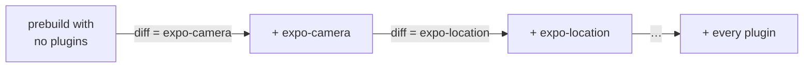

# expo-plugin-blame

[](https://www.npmjs.com/package/expo-plugin-blame) [](https://github.com/FladioArmandika/expo-plugin-blame/actions/workflows/ci.yml) [](LICENSE)

**`git blame` for `expo prebuild`.** Find out which config plugin wrote every line in your `android/` and `ios/` folders, and catch plugins quietly undoing each other's work.

```sh
npx expo-plugin-blame --html
```


## Sound familiar?

With Continuous Native Generation, nobody writes `android/` and `ios/` by hand. A dozen plugins write them for you, and when something looks off there's no history to ask. Here's what expo-plugin-blame says about three classic mysteries, taken from the [demo app](examples/demo):

> **"Why does my Android app ask for the microphone?"**
> ```
> expo-camera                        AndroidManifest.xml +2, Info.plist +4
> ```
> Open the report and the `RECORD_AUDIO` line is coloured `expo-camera`. It adds the permission unless you set `recordAudioAndroid: false`.

> **"I set `minSdkVersion` to 24 and the build still says 26."**
> ```
> ./plugins/withMinSdk24.ts          no native changes
> ```
> Your plugin ran, and its edit was lost. When two plugins use the same kind of mod, Expo runs the later plugin's edit *first*, so `expo-build-properties` (declared earlier) wins. No diff would ever show you that.

> **"Who changed my camera permission text?"**
> ```
> ⚠ Info.plist: ./plugins/withCameraCopy.ts changed lines written by expo-camera
> ```
> Two plugins wrote the same line, and the later one won. Here it's on purpose. Usually it isn't.

## Quick start

In any Expo project with dependencies installed:

```sh
npx expo-plugin-blame              # who wrote what, in the terminal
npx expo-plugin-blame --html       # plus a colour-coded report you can click through
npx expo-plugin-blame --base main  # what this branch changes, and which plugin did it
```

It works on a temporary copy, so your project and its `android/` and `ios/` folders are never touched. Node 22.13+ (same as Expo SDK 58).

### Reading the output

```
expo-plugin-blame · SDK 58 · 7 plugins · 8 prebuilds in 4.2s
  expo-camera                        AndroidManifest.xml +2, Info.plist +4
  expo-location                      AndroidManifest.xml +2, Info.plist +13
  expo-build-properties              gradle.properties +1, Podfile.properties.json +5 -1
  ./plugins/withCameraCopy.ts        Info.plist +1 -1
  ./plugins/withMinSdk24.ts          no native changes
  ./plugins/withDangerousPodfile.ts  Podfile +2
  ./plugins/withXcodeResource.ts     project.pbxproj +4, extra.json +1 (new)
  ⚠ Info.plist: ./plugins/withCameraCopy.ts changed lines written by expo-camera
  · AndroidManifest.xml touched by expo-camera, expo-location
Report: expo-plugin-blame.html
```

| You see | It means |
| --- | --- |
| `⚠ changed lines written by…` | A plugin overwrote another plugin's lines. Worth a look every time. |
| `· touched by…` | Several plugins edit one file, on different lines. Usually fine. |
| `no native changes` | Either the plugin has nothing to do, or its edit got lost. |
| `(auto)` | Expo applies this package's plugin because it's installed, even though it isn't in your `plugins` list. |

The HTML report is one self-contained file. **By file** colours every line by the plugin that wrote it, **By plugin** shows each plugin's diff, and clicking a plugin highlights its lines everywhere.

## Review native changes on every PR

Upgrading a plugin or tweaking `app.config.ts` changes native code that nobody sees in review, because `android/` and `ios/` aren't committed. The GitHub Action fixes that: every PR that changes the generated files gets a comment saying what changed and which plugin did it.


That's a real run: the branch removed `expo-location` from `plugins`. Expo still applies it because the package is installed, but without your options, so the custom permission text quietly went back to the default.

```yaml
# .github/workflows/expo-plugin-blame.yml
name: expo-plugin-blame
on: pull_request

permissions:
  contents: read
  pull-requests: write

jobs:
  expo-plugin-blame:
    runs-on: ubuntu-latest
    steps:
      - uses: actions/checkout@v4
      - uses: actions/setup-node@v4
        with:
          node-version: 22
          cache: npm
      - run: npm ci
      - uses: FladioArmandika/expo-plugin-blame@main
```

It runs on plain Linux, since nothing gets compiled. One comment per PR, updated on each push, and no comment at all while a PR doesn't touch native output. The report also goes to the job summary, which is where PRs from forks get it.

<details>
<summary>Inputs and outputs</summary>

| Input | Default | What it does |
| --- | --- | --- |
| `working-directory` | `.` | The Expo project folder, for monorepos |
| `base` | the PR's base branch | Any branch, tag or commit to compare with |
| `platform` | `all` | `ios`, `android` or `all` |
| `comment` | `true` | `false` writes only the job summary |

Outputs: `changed` (`true` or `false`), `markdown-file` and `json-file`, for failing the job or posting the report somewhere else.

</details>

## Compare with any branch

The same comparison works locally:

```
$ npx expo-plugin-blame --base main

expo-plugin-blame · main (e3c1fda) → working tree · SDK 58 · 15 prebuilds in 6.8s
  expo-camera                                  AndroidManifest.xml -1
  expo-build-properties                        Podfile.properties.json +1 -1, project.pbxproj +2 -2
  expo-location (auto)                         Info.plist +1 -1
  ./plugins/withDangerousPodfile.ts (removed)  Podfile -2
  · project.pbxproj is now touched by expo-build-properties, ./plugins/withXcodeResource.ts
  5 generated files changed
```

It checks `main` out into a temporary git worktree, blames both sides and diffs the result. Changed options and upgraded plugin versions show up under the plugin's name, **(new)** and **(removed)** mark plugins only one side has, and **Expo defaults** is the template itself, which mostly moves on SDK upgrades. If your dependencies differ from the base's, it installs the base's first (lifecycle scripts skipped). Add `--markdown pr.md` to get the PR comment as a file.

## How it works



1. Copy the project to a temp folder, with `node_modules` symlinked.
2. Run the real `expo prebuild` with no plugins, then again with one more plugin each time, in your order, in parallel.
3. Diff each run against the one before. Whatever changed belongs to the plugin that was just added.
4. Track every line through the steps, so a line that a later plugin rewrites is caught as an overwrite.

Three things make that harder than it sounds:

- **Expo auto-applies plugins.** Install `expo-camera` and its plugin runs even when it isn't in your list, so a naive "no plugins" baseline already has camera permissions. expo-plugin-blame keeps those out of the baseline until their own step, so they're blamed by name.
- **Xcode ids are random.** Plugins that add files to `project.pbxproj` get fresh UUIDs on every run. They're renamed to content hashes before diffing, so only real changes show up.
- **Prebuilds aren't free.** Each step's output is cached in `node_modules/.cache/expo-plugin-blame`. Run it twice and the second run takes half a second. Edit your last plugin and it re-runs one prebuild, not all of them.

The research behind this, including how the auto-applied plugins work, is in [docs/risk-checks.md](docs/risk-checks.md).

## Options

| Flag | What it does |
| --- | --- |
| `--html [file]` | Write the HTML report (default `expo-plugin-blame.html`) |
| `--base <git-ref>` | Compare with a branch, tag or commit |
| `--markdown <file>` | Write a Markdown summary sized for a PR comment (`-` for stdout) |
| `--json <file>` | Write everything, including per-line blame and patches (`-` for stdout) |
| `--platform ios\|android\|all` | Only prebuild one platform (default `all`) |
| `--only a,b` | Only report these plugins. Earlier plugins still run. |
| `--concurrency <n>` | Prebuilds to run at once (default: CPU count) |
| `--no-cache` | Run every prebuild, ignoring the cache |
| `--keep-temp` | Keep the temp copies so you can poke around |

## FAQ

**Does it change my project?** No. Everything happens in temp copies that are deleted afterwards. The only thing written to your project is the cache in `node_modules/.cache`.

**Does it work with `app.config.ts`?** Yes, including inline function plugins. `app.json` and `app.config.js` work too.

**Which SDKs?** It's tested on SDK 58. It relies on public pieces of Expo's config plugin system, so nearby versions should work. Please open an issue if yours doesn't.

**When should I use `--no-cache`?** When a plugin reads environment variables, or a local plugin imports another plugin's file. The cache key covers your project files, dependencies, plugin options and the tool's own version, but not those.

**Bare React Native?** No. It explains what `expo prebuild` generates. It doesn't fix anything or run native builds either. It just tells you who did what.

*expo-plugin-blame was called `prebuild-blame` up to 0.1.0.*

## Contributing

<details>
<summary>Building, testing and the code layout</summary>

Written in TypeScript, built with tsup and tested with Vitest.

```sh
npm install
npm run build && npm test
npm run typecheck
node dist/cli.js path/to/expo-app   # try your build on a project
```

The end-to-end tests run real `expo prebuild`s on `test/fixtures/basic`. Run `npm install` in that folder first, or they're skipped. To try the demo, run `npm install` in `examples/demo`, then `node dist/cli.js examples/demo --html`.

```
src/
  cli.ts                 flags and output
  run.ts                 ties it together
  expo.ts                reads the project with its own Expo install
  workspace.ts           temp copies of the project
  prebuild.ts            runs expo prebuild, in parallel
  snapshot.ts            reads android/ and ios/, normalizes pbxproj
  blame.ts               line-level attribution and overlaps
  base.ts                checks out --base into a git worktree
  cache.ts               per-step cache keys and storage
  compare.ts             what changed since --base, and whose it is
  report/terminal.ts     the terminal summary
  report/html.ts         the HTML report
  report/markdown.ts     Markdown summaries for PR comments
  normalize/pbxproj.ts   stable Xcode object ids
  steps.ts               which plugins run at each step
  runtime/app-config.ts  loaded by Expo inside each temp copy
test/
  fixtures/basic/        small Expo app with real and local plugins
examples/demo/           the app behind the output and GIF above
scripts/record-gif.cjs   re-records docs/report.gif
action.yml               the GitHub Action
```

</details>

## License

[MIT](LICENSE)
