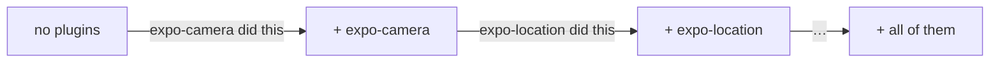

# expo-plugin-blame

[](https://www.npmjs.com/package/expo-plugin-blame) [](https://github.com/FladioArmandika/expo-plugin-blame/actions/workflows/ci.yml) [](LICENSE)

`git blame`, but for `expo prebuild`.

Your `android/` and `ios/` folders are written by a bunch of config plugins. When something weird shows up in there, this tells you which plugin did it.

```sh
npx expo-plugin-blame --html
```


## Whodunit?

Real cases from the [demo app](examples/demo).

**Why does my app want the microphone?**

```
expo-camera    AndroidManifest.xml +2, Info.plist +4
```

expo-camera adds `RECORD_AUDIO` unless you set `recordAudioAndroid: false`.

**I set `minSdkVersion` to 24. Why is it still 26?**

```
./plugins/withMinSdk24.ts    no native changes
```

Your plugin ran, it just got overruled. Expo applies edits to the same file in reverse order, so `expo-build-properties` (listed earlier) gets the last word. Good luck spotting that in a diff.

**Who changed my camera permission text?**

```
⚠ Info.plist: ./plugins/withCameraCopy.ts changed lines written by expo-camera
```

Two plugins, one line. The later one won.

## Use it

```sh
npx expo-plugin-blame              # summary in your terminal
npx expo-plugin-blame --html       # the colourful report from the GIF
npx expo-plugin-blame --base main  # what changed since main, and who did it
```

It works on a temp copy, so your project stays untouched. Needs Node 22.13+.

What the symbols mean:

- `⚠` a plugin overwrote another plugin's lines. Worth a look.
- `·` a few plugins edit the same file. Usually fine.
- `no native changes` the plugin did nothing, or got overruled.
- `(auto)` Expo applied it because the package is installed, even though it's not in your `plugins`.

## A comment on every PR

`android/` and `ios/` aren't in git, so nobody reviews them. This Action does.


That's a real run. Someone removed `expo-location` from `plugins`. Expo still applies it because the package is installed, just without your options, so the custom permission text quietly went back to the default.

```yaml
# .github/workflows/expo-plugin-blame.yml
name: expo-plugin-blame
on: pull_request

permissions:
  contents: read
  pull-requests: write

jobs:
  blame:
    runs-on: ubuntu-latest
    steps:
      - uses: actions/checkout@v4
      - uses: actions/setup-node@v4
        with:
          node-version: 22
          cache: npm
      - run: npm ci
      - uses: FladioArmandika/expo-plugin-blame@v1
```

One comment per PR, updated on every push. If a PR doesn't touch native output, it stays quiet.

<details>
<summary>Inputs and outputs</summary>

| Input | Default | What it does |
| --- | --- | --- |
| `working-directory` | `.` | The Expo project folder, for monorepos |
| `base` | the PR's base branch | Any branch, tag or commit to compare with |
| `platform` | `all` | `ios`, `android` or `all` |
| `comment` | `true` | `false` writes only the job summary |

Outputs: `changed` (`true` or `false`), `markdown-file` and `json-file`.

PRs from forks can't get comments, so for those the report goes to the job summary.

</details>

## How it works

Run prebuild with no plugins. Add one plugin, run again, diff. Repeat until every plugin is in. Whatever changed at each step belongs to the plugin you just added.



The annoying parts are handled for you:

- Expo secretly applies plugins for installed packages. They get their own step instead of hiding in the baseline.
- Xcode gives new objects random ids on every run. Those get normalized, so you only see real changes.
- Every step is cached. Running it again takes about half a second.

If you like the gory details, see [docs/risk-checks.md](docs/risk-checks.md).

<details>
<summary>All the flags</summary>

| Flag | What it does |
| --- | --- |
| `--html [file]` | Write the HTML report (default `expo-plugin-blame.html`) |
| `--base <git-ref>` | Compare with a branch, tag or commit |
| `--markdown <file>` | Markdown summary for a PR comment (`-` for stdout) |
| `--json <file>` | Everything, including per-line blame (`-` for stdout) |
| `--platform ios\|android\|all` | Only prebuild one platform (default `all`) |
| `--only a,b` | Only report these plugins |
| `--concurrency <n>` | Prebuilds at once (default: CPU count) |
| `--no-cache` | Ignore the cache and run everything |
| `--keep-temp` | Keep the temp copies so you can poke around |

</details>

## FAQ

**Will it mess with my project?**
No. It only writes a cache to `node_modules/.cache`.

**`app.config.ts`?**
Yep, inline function plugins too.

**Which Expo SDK?**
Tested on SDK 58. If yours breaks, [open an issue](https://github.com/FladioArmandika/expo-plugin-blame/issues).

**Bare React Native?**
Nope. This is about what `expo prebuild` generates.

**The result looks stale.**
Run with `--no-cache`. The cache can't tell when a plugin reads env vars.

Formerly known as `prebuild-blame`.

## Contributing

<details>
<summary>Building, testing and the code layout</summary>

Written in TypeScript, built with tsup and tested with Vitest.

```sh
npm install
npm run build && npm test
npm run typecheck
node dist/cli.js path/to/expo-app   # try your build on a project
```

The end-to-end tests run real `expo prebuild`s on `test/fixtures/basic`. Run `npm install` in that folder first, or they're skipped. To try the demo, run `npm install` in `examples/demo`, then `node dist/cli.js examples/demo --html`.

```
src/
  cli.ts                 flags and output
  run.ts                 ties it together
  expo.ts                reads the project with its own Expo install
  workspace.ts           temp copies of the project
  prebuild.ts            runs expo prebuild, in parallel
  snapshot.ts            reads android/ and ios/, normalizes pbxproj
  blame.ts               line-level attribution and overlaps
  base.ts                checks out --base into a git worktree
  cache.ts               per-step cache keys and storage
  compare.ts             what changed since --base, and whose it is
  report/terminal.ts     the terminal summary
  report/html.ts         the HTML report
  report/markdown.ts     Markdown summaries for PR comments
  normalize/pbxproj.ts   stable Xcode object ids
  steps.ts               which plugins run at each step
  runtime/app-config.ts  loaded by Expo inside each temp copy
test/
  fixtures/basic/        small Expo app with real and local plugins
examples/demo/           the app behind the output and GIF above
scripts/record-gif.cjs   re-records docs/report.gif
action.yml               the GitHub Action
```

</details>

## License

[MIT](LICENSE)
