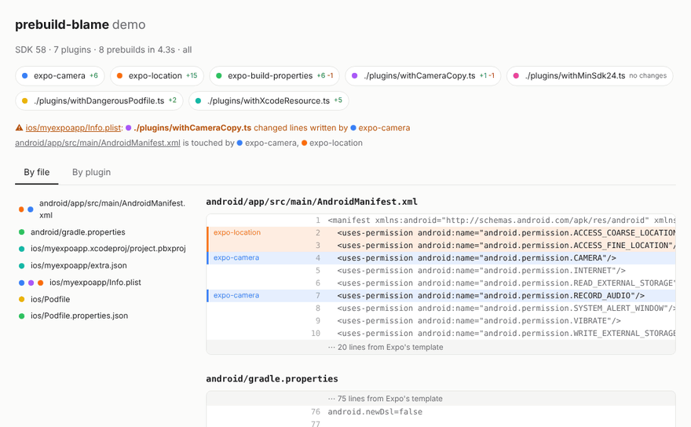

# prebuild-blame

**`git blame` for `expo prebuild`. See which config plugin wrote which lines in your `android/` and `ios/` folders.**



> 🚧 **Work in progress.** It works and is tested against real prebuilds, but it isn't on npm yet.

## Why

Something weird shows up in your `AndroidManifest.xml` or `project.pbxproj` after prebuild, and you have no idea which plugin put it there. Expo's debugging tools show you the config, not the native files. `git diff` tells you *what* changed, but not *who* did it.

## How it works

1. Copies your project to a temp folder, with `node_modules` symlinked instead of copied. Your real project is never touched.
2. Runs prebuild with none of your plugins, then again with one more plugin each time, in the order you declared them.
3. Diffs each run against the one before, so every change lands on the plugin that introduced it.
4. Normalizes `project.pbxproj` first, so random Xcode UUIDs don't show up as fake changes.
5. Flags files touched by more than one plugin, which is where plugins tend to step on each other.

**The sneaky part:** Expo quietly auto-applies some plugins, like `expo-camera` and `expo-location`, whenever the package is installed. That means a naive "no plugins" baseline still contains them. prebuild-blame keeps them out of the baseline so their changes are blamed on the right name. The details are in [docs/risk-checks.md](docs/risk-checks.md).

## What it looks like

This is the real output on [examples/demo](examples/demo), a fresh SDK 58 app with a few plugins:

```
$ npx prebuild-blame --html

prebuild-blame · SDK 58 · 7 plugins · 8 prebuilds in 4.2s
  expo-camera                        AndroidManifest.xml +2, Info.plist +4
  expo-location                      AndroidManifest.xml +2, Info.plist +13
  expo-build-properties              gradle.properties +1, Podfile.properties.json +5 -1
  ./plugins/withCameraCopy.ts        Info.plist +1 -1
  ./plugins/withMinSdk24.ts          no native changes
  ./plugins/withDangerousPodfile.ts  Podfile +2
  ./plugins/withXcodeResource.ts     project.pbxproj +4, extra.json +1 (new)
  ⚠ Info.plist: ./plugins/withCameraCopy.ts changed lines written by expo-camera
  · AndroidManifest.xml touched by expo-camera, expo-location
Report: prebuild-blame.html
```

The HTML report (the GIF above) is a single file you can open anywhere. **By file** shows every generated file with each line coloured by the plugin that wrote it. **By plugin** shows each plugin's diff. Click a plugin to highlight its lines.

### Reading the output

- **⚠ changed lines written by…** means a plugin rewrote lines another plugin wrote. Here, `withCameraCopy` replaced expo-camera's permission text. That's on purpose here, but it's exactly how plugins break each other by accident.
- **· touched by…** means several plugins edit the same file, on different lines. Usually fine, and worth knowing about.
- **no native changes** on a plugin that should change something means its edit got lost. `withMinSdk24` sets `minSdkVersion` to 24, but when two plugins edit the same file through the same kind of mod, Expo runs the later plugin's edit *first*. So expo-build-properties, declared earlier, wins and writes 26. Plain `git diff` would never show you that.
- **(auto)** marks packages Expo applies on its own because they're installed, even though they aren't in your `plugins` list.

## Usage

Not on npm yet, so for now run it from a clone:

```sh
git clone https://github.com/FladioArmandika/prebuild-blame && cd prebuild-blame
npm install && npm run build
node dist/cli.js path/to/your/expo-app
```

Once it's published, it'll be `npx prebuild-blame` in your project.

| Flag | What it does |
| --- | --- |
| `--html [file]` | Write the HTML report (default `prebuild-blame.html`) |
| `--platform ios\|android\|all` | Only prebuild one platform (default `all`) |
| `--only a,b` | Only report these plugins. Earlier plugins still run. |
| `--json <file>` | Write the full result, including per-line blame and patches. Use `-` for stdout. |
| `--concurrency <n>` | Prebuilds to run at once (default: CPU count) |
| `--keep-temp` | Keep the temp copies so you can poke around |

Works with `app.json` and with `app.config.ts`/`.js`, including inline function plugins. Requires Node 20.12+ and your project's dependencies installed. It's tested on SDK 58 so far.

## Status

- [x] Stable `project.pbxproj` normalization
- [x] Per-plugin steps that keep Expo's auto-applied plugins out of the baseline
- [x] CLI: temp workspace, parallel prebuilds, line-level blame, terminal summary, JSON output
- [x] Overlap and conflict flags
- [x] Colour-coded HTML report
- [ ] Cache the baseline between runs
- [ ] `--base <git-ref>` to compare native output between two commits
- [ ] GitHub Action that posts the summary on PRs

## Not in scope

It doesn't fix anything, run native builds, or support bare React Native without Expo prebuild. It just tells you who did what.

## Development

Written in TypeScript, built with tsup, and tested with Vitest.

```sh
npm install
npm run build && npm test
npm run typecheck
```

```
src/
  cli.ts                 flags and output
  run.ts                 ties it together
  expo.ts                reads the project with its own Expo install
  workspace.ts           temp copies of the project
  prebuild.ts            runs expo prebuild, in parallel
  snapshot.ts            reads android/ and ios/, normalizes pbxproj
  blame.ts               line-level attribution and overlaps
  report/terminal.ts     the terminal summary
  report/html.ts         the HTML report
  normalize/pbxproj.ts   stable Xcode object ids
  steps.ts               which plugins run at each step
  runtime/app-config.ts  loaded by Expo inside each temp copy
test/
  fixtures/basic/        small Expo app with real and local plugins
examples/demo/           the app behind the output and GIF above
scripts/record-gif.cjs   re-records docs/report.gif
```

The end-to-end tests run real `expo prebuild`s on `test/fixtures/basic`. Run `npm install` in that folder first, or they're skipped. To try the demo, run `npm install` in `examples/demo`, then `node dist/cli.js examples/demo --html`.

## License

[MIT](LICENSE)
